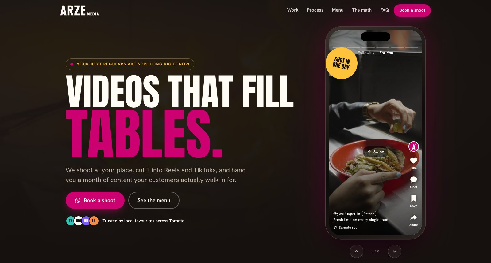

# Arze Media

Website for Arze Media, a Toronto video studio for restaurants that runs on an AI-assisted pipeline: one shoot becomes a month of Reels and TikToks, built to deliver in days, not weeks.
Owners see the work, pick a package, check if it pays off and book on WhatsApp, no calls needed.

Live: https://arze-media.pages.dev

## What's inside

- A phone that plays sample reels, with swipe and tap like the real apps.
- A video menu of packages and a break-even calculator for restaurant owners.
- Contact through WhatsApp, email or a form that lands in the inbox.
- Every price, video and line of copy lives in one file: `js/config.js`.
